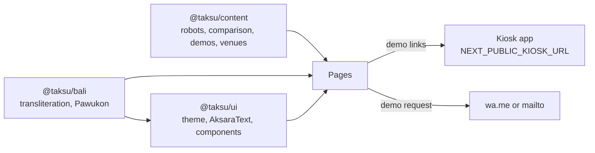

# Architecture

The web app is the product site for Taksu Tech's reception robots: Snow and Timo in a Bali Edition,
and Taksu Kiosk, a static kiosk Taksu Tech builds itself. It is a Next.js app that lives at
`apps/robot` in the [TaksuTech](https://github.com/DarmawanWeb/TaksuTech) workspace, reads the
robots from `@taksu/content`, and opens its demos in the
[kiosk app](https://github.com/DarmawanWeb/reception-robot-kiosk), the app on the robots' screens.

## Stack

| Part | Choice |
|---|---|
| Framework | Next.js 16, App Router, Turbopack, `output: 'standalone'`, pages prerendered per locale |
| UI | React 19, Tailwind CSS 4, components from `@taksu/ui`, lucide-react icons |
| Theme | `@taksu/ui/theme.css`, the reception line's Bali theme; light and dark (next-themes), following the system until the visitor picks |
| Languages | next-intl 4, `/id` (default) and `/en`, prefix always present |
| Data | `@taksu/content`: TypeScript objects, no database and no API |
| Bali | `@taksu/bali`: Aksara Bali transliteration and the Pawukon calendar |
| Fonts | Plus Jakarta Sans (text), Bricolage Grotesque (headings), Noto Serif Balinese (Aksara Bali), self-hosted from Fontsource |
| Tests | Vitest for the message files and the link builders |

The build tracing root is the workspace root (`next.config.ts`), so the standalone output carries
the shared packages and `docker/Dockerfile` in the workspace can copy it as is. The three
workspace packages ship TypeScript source, so they are listed in `transpilePackages`.

## Routes and languages

Every page is under `src/app/[locale]/` and prerendered for both languages
(`generateStaticParams`). Robot pages sit at the top level, one per robot in `@taksu/content`, with
`dynamicParams = false`, so any other single segment is a 404. Other unknown paths inside a locale
go to `[...rest]`, which shows the localized not-found page; `src/app/not-found.tsx` is a
two-language fallback for requests outside any locale.

| Path | Page |
|---|---|
| `/` | Home: Om Swastiastu hero with a demo, the line-up, the kiosk app's screens, why the robots stay in daily use, the Aksara Bali rule and today's Pawukon day, use cases, how installation works |
| `/snow`, `/timo`, `/kiosk` | Robot page (`[robot]`): edition, kind, price tier, summary, height, specs, local content, features, Balinese touches, ideal venues, its own start screen and demo, the other two robots |
| `/compare` | The three robots side by side, from `comparison` |
| `/aksara-bali` | The regulation, a live sign preview, a guest-name writer, the review note |
| `/demo` | Each robot at its sample venue, the Studio, the kiosk launcher |
| `/contact` | Demo request form and direct contact |
| `/sitemap.xml`, `/robots.txt` | Every page in both languages |

`src/i18n/routing.ts` takes the locales and the default (`id`) from `@taksu/content`, with the
prefix always present. `src/proxy.ts` runs next-intl's middleware on every path except `api`,
`_next`, `_vercel`, and files with an extension. `src/i18n/request.ts` loads
`messages/<locale>.json` with the `Asia/Makassar` time zone (Bali time). The messages are typed
from `messages/id.json` in `src/types/next-intl.d.ts`, so a missing key fails the typecheck, and
`src/messages.test.ts` fails when the two files have different keys.

Pages call `resolveLocale(params)` (`src/lib/locale.ts`), which rejects an unknown locale and
enables static rendering; metadata functions use `localeFromParams`. The language menu keeps the
visitor on the same page.

## Robot facts

`@taksu/content` is the single source of truth for the robots. Pages pick the locale's string with
`pick()`; no page types a height, a spec, or a comparison value.

| Content file | Used for |
|---|---|
| `reception.ts` | `robots` (name, edition, kind, height, tagline, summary, appearance, capabilities, specs, features, Balinese touches, ideal venues, price tier, local content, demo venue), `comparison`, `useCases`, `receptionProcess`, `aksaraRegulation`, `specSourceNote` |
| `demos.ts` | `demos`: one kiosk demo per robot at its sample venue, and the Studio |
| `sites/` | `getSite()`: the sample venues the demos open (`kantor-layanan`, `resort`) |
| `brand.ts`, `names.ts` | Contact person, email, and location; the company name and the line's name |
| `i18n.ts` | `locales`, `defaultLocale`, `localeLabels`, `pick()` |

The line's own name is `names.robot` in `names.ts`. It is not final, so components read it from
there and messages take it as `{brand}`; nothing types it.

The line-up (`components/robots/lineup.tsx`) draws each robot's illustration from `@taksu/ui`
(`RobotIllustration`), cropped from head to floor, at its `heightCm` against a ruler that runs to
175 cm. The site shows a price tier (most affordable, mid-range, premium), never a price. Robot
pages show the Snow and Timo Bali Edition image for the mobile robots and the Taksu Kiosk image for
the kiosk.

The mobile robots show `specSourceNote` under their specifications: they may vary by
configuration. The site claims no TKDN percentage for Taksu Kiosk: it says the kiosk is being
prepared for TKDN certification, and that the percentage follows official certification.

## Aksara Bali and the Bali theme

Aksara Bali is generated, not typed. `transliterate()` in `@taksu/bali` is rule-based: plain `e`
reads as pepet and `é` as taling, a small lexicon covers common names, and digits become Balinese
numerals. `AksaraText` in `@taksu/ui` renders the result in Noto Serif Balinese with
`lang="ban-Bali"` and the line height stacked signs need; `decorative` hides a line that repeats
Latin text already on screen from screen readers.

| Where | What |
|---|---|
| Wordmark | The line's name in Aksara Bali above the Latin, as on Balinese signs |
| Home hero | Om Swastiastu in its established spelling (`OM_SWASTIASTU` from `@taksu/bali`) |
| Pawukon today | Today's day in Aksara Bali above the Latin |
| `/aksara-bali` | `AksaraSignage`, a sign with the name above the Latin, and `NameWriter` from `@taksu/ui` for guest names |

Because the transliteration is automatic, official signage text must still be reviewed by a
Balinese language adviser; `/aksara-bali` says so under the regulation.

`PawukonToday` works out today's Pawukon day in the browser, in Bali time, so a static page never
shows a stale date. It shows the day and wuku, a greeting on a holy day, and the days until the
next one.

`src/app/globals.css` imports Tailwind, then `@taksu/ui/theme.css`, and adds the ui package as a
`@source`. The theme names its palette after Balinese materials: Paras stone for the light page,
Endek indigo for actions, Malam night indigo for the dark page, Prada gold for actions in the dark
and for ornaments, and Subak water for calm accents. The `dark` class switches an element to the
dark tokens, so `dark bg-background` makes a night-indigo band: the hero, the why-venues column,
the robot demo band, the kiosk launcher card, and the call to action. The poleng band
(`PolengBand`) and the candi bentar mark (`LogoMark`, also `src/app/icon.svg`) come from
`@taksu/ui` too. This styling belongs to the reception line and the kiosk only; the company
profile (`company.css`) and the education robots (`edu.css`) stay plain.

## Kiosk captures and demo links

`src/assets/screens/id/` and `src/assets/screens/en/` hold the same eight WebP captures of the
kiosk app, one set per language:

| Capture | Taken from | Shown on |
|---|---|---|
| `home`, `voice`, `queue`, `guestbook`, `route`, `aksara` | Timo at the sample public service office, 1600 x 900 | The home page tabs; `home` is also Timo's start screen |
| `snow-home` | Snow at the sample resort, 1600 x 900 | Snow's page and demo card |
| `kiosk-home` | The Taksu Kiosk totem, 900 x 1600 | Taksu Kiosk's page and demo card |

`src/lib/screens.ts` imports them statically, so Next.js knows their sizes, and returns the one in
the page's language: `screenImage(locale, key)` for the tabs, `robotScreen(locale, robot)` for a
robot's start screen (portrait for the totem). The tabs (`components/robots/screen-showcase.tsx`)
follow the arrow keys, Home, and End, and keep every capture mounted so switching never waits on a
download.

`src/lib/links.ts` builds every link into the kiosk app from `NEXT_PUBLIC_KIOSK_URL`, always with
the locale. Demo links open in a new tab and tell screen readers so.

| Link | Built with | Opens |
|---|---|---|
| Line-up, robot page, robot demo band | `robotDemoUrl(locale, robot.slug, robot.demoSite)` | `/<locale>/<robot>/<venue>` |
| Home hero, "Talk to a robot" | `robotDemoUrl(locale, 'snow', 'resort')` | Snow at the resort |
| Home tabs, "Try it in the demo" | `robotDemoUrl(locale, 'timo', 'kantor-layanan')` | Timo at the public service office |
| Use case, "See an example" | The first recommended robot at the use case's venue | `/<locale>/<robot>/<venue>` |
| `/demo` robot cards | `kioskUrl(locale, demo.path)` from `demos` | Snow and Timo at their venues; Taksu Kiosk at `/<locale>/kiosk/kantor-layanan/preview` |
| `/demo` Studio and launcher | `kioskUrl(locale, '/studio')`, `kioskUrl(locale)` | `/<locale>/studio`, the kiosk app's root |

The `/preview` path opens the totem standing in its frame, so a laptop shows its real portrait
layout.

## The demo request

`components/contact/demo-form.tsx` writes the request in the browser from `Contact.form.template`
(name, organisation, type of venue, robot of interest, message) and hands it to WhatsApp in a new
tab (`wa.me`) or to the mail app (`mailto:`), so the site stays static with no form backend. Name,
organisation, and message are required. Without a WhatsApp number the WhatsApp button is disabled
with a note, and the WhatsApp links in the footer and on the contact page are hidden.

## Metadata and sitemap

The layout sets `metadataBase` from `NEXT_PUBLIC_ROBOT_URL`, the default title from `Meta.title`,
and the title template `<page> | <line name>`. `pageMetadata()` (`src/lib/metadata.ts`) writes each
page's canonical URL, hreflang alternates for both languages, Open Graph (`id_ID` or `en_US`), and
the social card `/og/<locale>.jpg` from `public/og` (1200 x 630), also as a large Twitter card. A
robot page's title is its name and edition, and its description is the robot's summary. The
browser theme colour is Paras `#eef0eb` in light and Malam `#0e1335` in dark.

`src/app/sitemap.ts` lists the home page, `/compare`, `/aksara-bali`, `/demo`, `/contact`, and a
page per robot, each in both languages with alternates. `src/app/robots.ts` allows everything and
points to the sitemap.

## Configuration

Public settings are inlined at build time (`src/lib/site-config.ts`):

| Variable | Purpose |
|---|---|
| `NEXT_PUBLIC_ROBOT_URL` | This site's address: canonical links, sitemap, social cards (default `http://localhost:3004`) |
| `NEXT_PUBLIC_KIOSK_URL` | The kiosk app, for every demo link (default `http://localhost:3001`) |
| `NEXT_PUBLIC_COMPANY_URL` | The company profile, linked from the footer and the why-venues table (default `http://localhost:3000`) |
| `NEXT_PUBLIC_WHATSAPP_NUMBER` | Where WhatsApp messages go, in international format without `+`; empty means email only |

The contact email is `brand.contact.email` in `@taksu/content`. In production the workspace's
`docker-compose.yml` passes these values to the `robot` image as build arguments, with this site
at `https://taksu-robot.agus-darmawan.com` by default.
